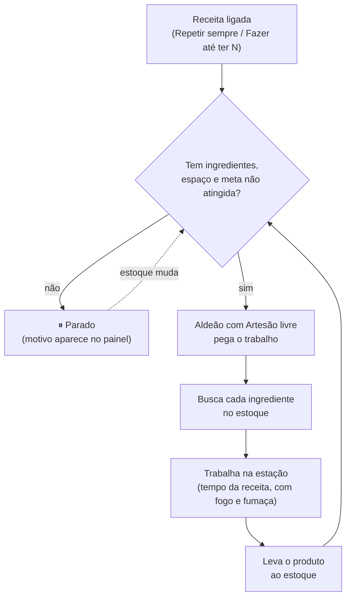
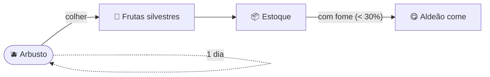
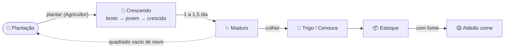
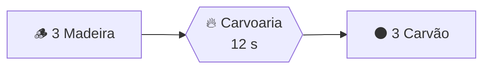
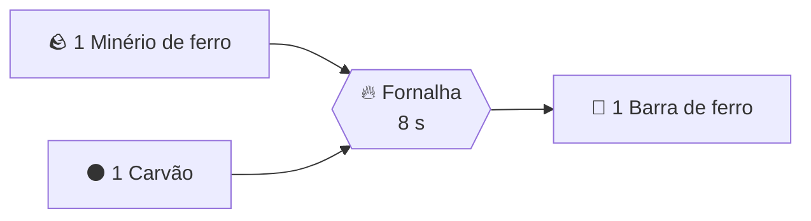
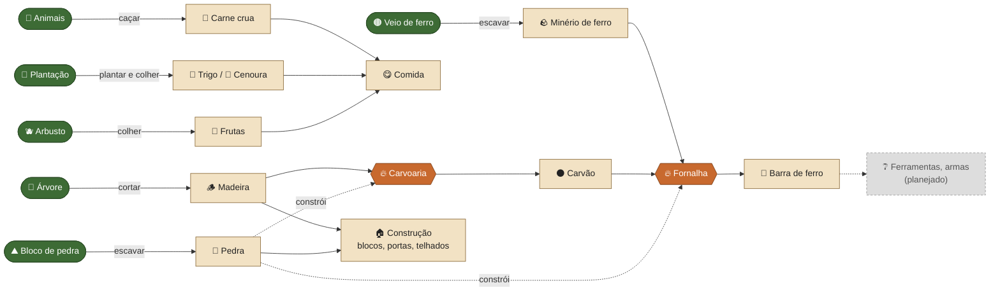

# Árvore de produção (crafting)

Inspirado no sistema de "contas" (bills) do RimWorld, simplificado. Os números ficam em
`scripts/crafting.gd` (`RECIPES`) e `scripts/game.gd` (`RESOURCES`). **Ao mudar uma receita lá,
atualize este arquivo.**

> Os fluxogramas são em Mermaid. No VS Code, abra a pré-visualização (Ctrl+Shift+V) com a extensão
> "Markdown Preview Mermaid Support" (`bierner.markdown-mermaid`) instalada. O GitHub mostra direto.

## Como funciona

1. **Construa a estação** no menu de construção (B), grupo **Produção**.
2. **Clique na estação** para abrir o painel. Cada receita tem um modo:
   - **Desligado**: não produz.
   - **Repetir sempre**: produz enquanto houver ingredientes e espaço no estoque.
   - **Fazer até ter N**: produz até o estoque ter N unidades do produto e volta a produzir quando cair abaixo.
3. **Um aldeão com "Artesão"** ligado na tabela de Trabalho (T) busca os ingredientes no estoque,
   trabalha na estação o tempo da receita e leva o produto ao estoque.

A estação pode parar por estes motivos (aparecem no painel): falta de ingrediente, meta atingida,
estoque sem espaço para o produto, ou nenhum aldeão com Artesão livre.

---

## Matérias-primas (de onde vêm)

| Recurso | Como conseguir | Cabe por quadrado de estoque |
|---|---|---|
| Madeira | Cortar árvores (ordem "Cortar árvores"): 2 / 4 / 6 por árvore pequena / média / grande | 10 |
| Pedra | Escavar blocos de pedra (ordem "Escavar"): 1 por bloco | 16 |
| Frutas silvestres | Colher arbustos (ordem "Colher frutas", trabalho Coletor): 3 / 5 / 7 por arbusto pequeno / médio / grande. O arbusto fica e as frutas voltam em 1 dia | 12 |
| Trigo | Plantação de trigo (trabalho Agricultor): 6 por quadrado, pronto em 1,5 dia | 15 |
| Cenoura | Plantação de cenoura (trabalho Agricultor): 4 por quadrado, pronta em 1 dia | 12 |
| Carne crua | Caçar (ordem "Caçar", trabalho Caçador): coelho 2, javali 5, cervo 6 por animal | 10 |
| Minério de ferro | Escavar blocos de minério (pedra com pontos cor de ferrugem): 1 por bloco. Aparece em veios na pedra até 10 blocos abaixo da superfície; à vista em montanhas e barrancos | 18 |

---

## Comida e fome

Cada aldeão tem uma barra de fome (no card da barra superior) que esvazia em 1 dia de jogo.
Abaixo de 30% ele termina a tarefa atual e vai comer no estoque. Sem comida, anda e trabalha na
metade da velocidade ("Faminto"). Uma colônia nova começa com 20 frutas.

| Comida | Sacia por unidade |
|---|---|
| Frutas silvestres | 20% da barra (5 frutas = barra cheia) |
| Cenoura | 25% da barra (4 cenouras = barra cheia) |
| Trigo (cru) | 10% da barra. Comida fraca: no futuro vira pão na cozinha |
| Carne crua | 15% da barra. No futuro, carne cozida na cozinha sacia mais |

O aldeão come o que estiver no quadrado de comida mais perto que tenha o bastante para encher a barra.

---

## Plantação

No painel da esquerda: **"+ Plantação"** e arraste sobre grama ou terra. O botão ao lado da plantação
troca a cultura (**Trigo ▸ / Cenoura ▸**). Aldeões com **Agricultor** plantam os quadrados vazios
(a grama vira terra arada) e colhem os maduros, sempre colhendo primeiro. Não precisa de sementes, e
as plantas crescem o ano todo (ainda não há estações).

| Cultura | Fica pronta em | Colheita por quadrado | Sacia |
|---|---|---|---|
| Trigo | 1,5 dia | 6 trigo | 10% cada |
| Cenoura | 1 dia | 4 cenouras | 25% cada |

---

## Caça

Animais aparecem em bandos ao redor da colônia (no máximo 14 vivos), pastam e fogem de quem chega
perto. Marque uma área com **"+ Caçar"**: aldeões com **Caçador** atiram com arco (alcance 10 blocos,
75% de acerto) nos animais dentro dela, depois limpam a carcaça e levam a carne ao estoque.

| Animal | Onde vive | Flechas para abater | Carne | Comportamento |
|---|---|---|---|---|
| Coelho | campos e florestas | 1 | 2 | foge cedo (4 blocos) |
| Cervo | florestas e campos | 3 | 6 | foge cedo (7 blocos) |
| Javali | florestas | 4 | 5 | não foge; ferido, corre atrás do caçador e o assusta |

---

## Carvoaria

Forno de barro em cúpula, como as carvoarias de verdade (forno "rabo-quente"): porta em arco,
respiros em volta da base e furo no topo. A madeira queima abafada até virar carvão.

- **Construção:** 6 pedra · ocupa 2×2, 2 de altura

| Receita | Ingredientes | Produto | Tempo |
|---|---|---|---|
| Carvão | 3 madeira | 3 carvão | 12 s |

---

## Fornalha

Forno de barro sobre base de pedra, com chaminé (estilo Castle Story). Funde minério com carvão.

- **Construção:** 8 pedra · ocupa 2×2, 2 de altura

| Receita | Ingredientes | Produto | Tempo |
|---|---|---|---|
| Barra de ferro | 1 minério de ferro + 1 carvão | 1 barra de ferro | 8 s |

---

## Árvore completa

Legenda: retângulo arredondado = fonte no mundo · retângulo = recurso · hexágono = estação ·
tracejado = uso futuro.

**Custo total de 1 barra de ferro:** 1 minério de ferro + 1 carvão (= 1 madeira).

---

## Planejado (ainda não existe)

- **Uso da barra de ferro:** ferramentas melhores, armas para soldados e arqueiros, peças de construção de metal.
- **Outros minérios:** carvão mineral, ouro, cobre...
- **Bancada / ferraria:** transforma barras em ferramentas e armas.
- **Culinária (estilo Minecraft):** estação de cozinha com receitas: sopa de cenoura, pão (trigo), bolo.
  Comida preparada sacia mais que a crua.
- **Novas culturas:** batata e outras.
- **Estações do ano:** crescimento e plantio mudam com a estação (ex.: inverno sem crescimento).

## Balanceamento (anotações)

- Carvão 1:1 com madeira, como no Valheim.
- Minérios fundem 1:1: 1 minério + 1 carvão → 1 barra. Minérios mais complexos podem custar mais no futuro.
- Carvoaria em lote de 3 por viagem; fornalha 1 por vez.
